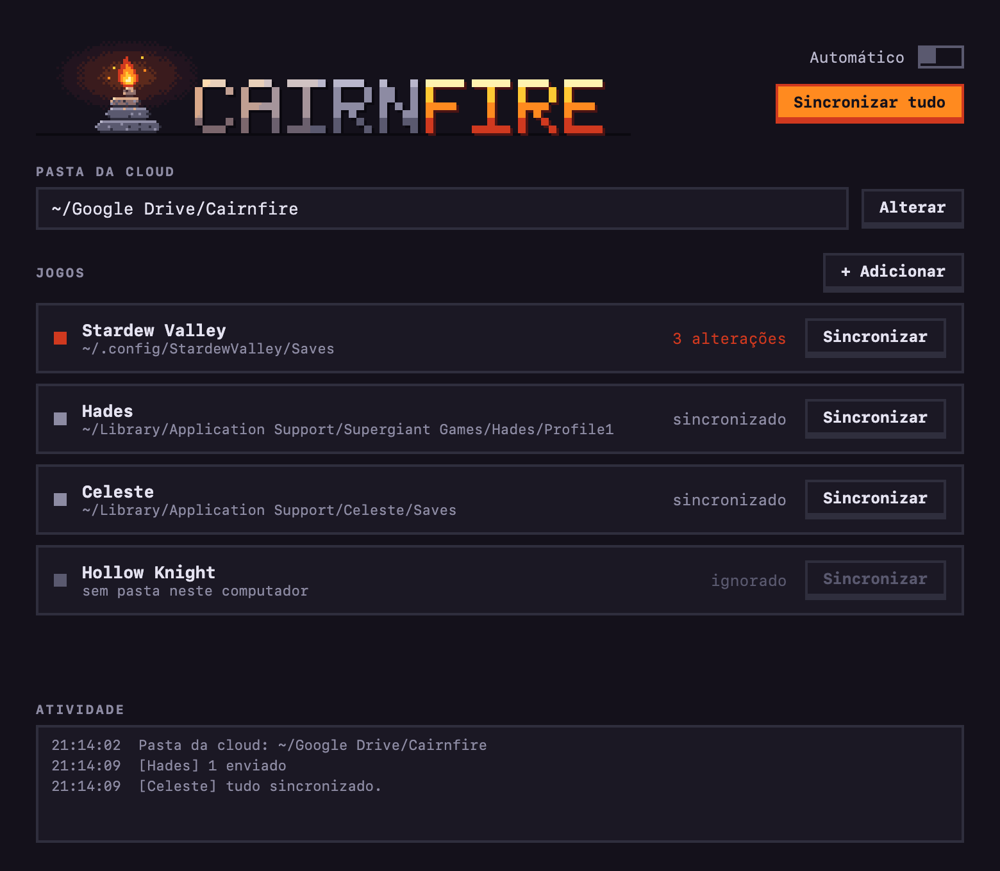

<h1 align="center">
  
</h1>

**Mantém os saves dos teus jogos iguais no PC Windows e no Mac, sem servidor e sem copiar ficheiros à mão.**

Escrito em [Kotlin](https://kotlinlang.org/) 

---

## O que é isto, em poucas palavras

Jogas no PC de manhã e queres continuar à noite no Mac? Normalmente tens de copiar os ficheiros de save de um
lado para o outro, e basta esqueceres-te uma vez para perderes horas de progresso.

O Cairnfire faz isso por ti. Tu dizes onde ficam os saves de cada jogo em cada computador, e ele usa uma pasta
da tua cloud (Google Drive, Dropbox, OneDrive…) como ponto de encontro:

```
  PC Windows                    Cloud                        Mac
 ┌───────────┐   envia    ┌───────────────┐   traz     ┌───────────┐
 │  saves A  │ ─────────► │ pasta partilh.│ ◄───────── │  saves B  │
 └───────────┘ ◄───────── └───────────────┘ ─────────► └───────────┘
                  traz                        envia
```

Quando acabas de jogar num computador, o Cairnfire envia o save novo para a cloud. Quando abres o outro, ele
traz-o. Se alguma coisa correr mal, a versão antiga fica guardada num backup.

> **Importante:** o Cairnfire não é uma cloud. Quem leva os ficheiros de uma máquina à outra é o teu Drive/Dropbox/
> OneDrive; o Cairnfire só decide *o que* copiar e protege-te de perder saves pelo caminho.

## Como decide o que copiar

A ideia mais simples seria "ganha o ficheiro mais recente", mas isso perde saves quando os dois computadores
mudam coisas diferentes. Por isso o Cairnfire guarda uma "fotografia" (um hash SHA-256) de cada ficheiro **na
última vez em que sincronizou** e compara três versões: a local, a da cloud e essa fotografia.

| Local | Cloud | O que acontece |
|-------|-------|----------------|
| mudou | igual à última vez | envia para a cloud |
| igual à última vez | mudou | traz da cloud |
| mudou | mudou | **conflito**: fica o mais recente e o outro vai para backup |
| ficheiro novo | não existe | envia para a cloud |
| apagado | igual à última vez | apaga também na cloud (com backup) |
| apagado | mudou | **não apaga**: mantém o ficheiro que foi alterado |

## Como o Cairnfire protege os teus saves

- **Backup antes de tudo.** Qualquer ficheiro que vá ser substituído ou apagado é primeiro copiado para
  `~/.cairnfire/backups/<jogo>/<data-hora>/`.
- **Cópia à prova de falhas.** Copia para um ficheiro temporário e só depois o move para o sítio final. Se o
  computador desligar a meio, nunca fica um save a metade.
- **Cloud não montada = não faz nada.** Se a pasta da cloud não existir (por exemplo, o Drive ainda não arrancou),
  o programa pára em vez de achar que "foi tudo apagado".
- **Pasta desaparecida = ignora o jogo.** Se uma pasta que já foi sincronizada deixar de existir (caminho errado,
  disco desligado), esse jogo é saltado em vez de apagar tudo do outro lado.
- **Espera que o jogo acabe de escrever.** No modo automático, só sincroniza depois de a pasta ficar uns segundos
  sossegada.
- **Ignora lixo do sistema:** `.DS_Store`, `Thumbs.db`, `desktop.ini`.

## Instalação

### O que precisas

- Um **JDK 17 a 21** (por exemplo [Temurin](https://adoptium.net/) 21) para compilar. O Gradle 8.14 e o Kotlin 2.1
  ainda não funcionam com JDK 25 ou mais recente.
  No macOS, se tiveres vários JDKs: `export JAVA_HOME=$(/usr/libexec/java_home -v 21)`
- Uma pasta de cloud sincronizada nos dois computadores (Google Drive, Dropbox, OneDrive…).

### Compilar

```bash
git clone https://github.com/goncalogatinho/cairnfire.git
cd cairnfire
./gradlew installDist          # no Windows: gradlew.bat installDist
```

O executável fica em `build/install/cairnfire/bin/cairnfire` (`cairnfire.bat` no Windows). Para o usares de
qualquer lado, adiciona essa pasta `bin` ao `PATH`.

### Versão sem Java instalado (opcional)

```bash
./gradlew jpackage
```

Gera em `build/jpackage/` uma app com um Java mínimo lá dentro (cerca de 90 MB, por causa da janela), por isso a
máquina onde a usares não precisa de ter Java:

- **macOS:** `build/jpackage/cairnfire.app` (executável em `cairnfire.app/Contents/MacOS/cairnfire`)
- **Windows:** `build\jpackage\cairnfire\cairnfire.exe` (linha de comandos) e `cairnfire-gui.exe` (abre a janela, sem consola)

O `jpackage` não faz cross-compile: corre o comando em cada sistema para gerar a versão desse sistema. A app não
está assinada, por isso, se a copiares de outro computador, o macOS pode bloqueá-la; o mais simples é compilar em
cada máquina.

## A janela

Para quem prefere cliques à linha de comandos, o Cairnfire também tem uma janela simples:

```bash
cairnfire gui
```

<p align="center">
  
</p>

- **Pasta da cloud** e **lista de jogos**, cada um com o seu estado: sincronizado, N alterações (laranja) ou
  conflito (vermelho). Clica num jogo para ver exatamente o que vai ser copiado.
- **Sincronizar** um jogo ou **Sincronizar tudo**. Antes de qualquer cópia, a janela mostra o que vai acontecer.
- **Adicionar / Editar / Remover** jogos. Remover só tira o jogo da lista: nunca apaga saves.
- **Automático** liga o modo `watch` dentro da janela (só enquanto ela estiver aberta). Para sincronizar também
  com a janela fechada, usa o `autostart`.
- **Atividade** mostra o que foi feito, com os erros a vermelho.

A janela usa o mesmo motor da linha de comandos, por isso as proteções (backups, cópia segura, cloud não montada)
são exatamente as mesmas. Na app empacotada (`jpackage`), abrir sem argumentos, por exemplo com duplo clique,
abre a janela.

## Começar a usar

**1. Em cada computador, uma vez:** diz qual é a pasta da cloud (cada máquina tem o seu caminho, mas é a mesma
pasta sincronizada).

```bash
cairnfire init --sync-root "~/Google Drive/Cairnfire"          # Mac
cairnfire init --sync-root "G:/O Meu Disco/Cairnfire"          # Windows
```

**2. Regista os jogos.** Podes dar os caminhos dos dois sistemas de uma vez (ou só o da máquina onde estás e
completar depois noutra). Exemplo com o Stardew Valley:

```bash
cairnfire add "Stardew Valley" \
  --windows "%APPDATA%/StardewValley/Saves" \
  --mac "~/.config/StardewValley/Saves"
```

Os caminhos aceitam `~`, `%VARIAVEL%` e `${VARIAVEL}`. O nome do jogo passa a ser o nome da pasta na cloud.

**3. Vê o que ia acontecer, e depois sincroniza:**

```bash
cairnfire status               # só mostra, não altera nada
cairnfire sync                 # sincroniza todos os jogos
cairnfire sync "Stardew Valley" --dry-run
```

Exemplo de saída:

```
[Stardew Valley] feito:
    local  -> cloud  Farm_123456/Farm_123456
 !  cloud  -> local  Farm_123456/SaveGameInfo  (alterado nos dois lados; a cloud é mais recente)
    (versões substituídas ou apagadas ficam em ~/.cairnfire/backups/Stardew Valley)
```

As linhas marcadas com `!` são conflitos: o mais recente ganhou e a outra versão está no backup.

## Todos os comandos

| Comando | O que faz |
|---|---|
| `init --sync-root <pasta>` | Define a pasta da cloud nesta máquina |
| `add <jogo> --windows <pasta> --mac <pasta>` | Regista um jogo (ou atualiza os caminhos de um já registado) |
| `list` | Lista os jogos registados |
| `status [jogo]` | Mostra o que seria copiado, sem alterar nada |
| `sync [jogo] [--dry-run]` | Sincroniza (um jogo ou todos) |
| `watch [--interval 60] [--debounce 5]` | Fica a correr e sincroniza sozinho |
| `gui` | Abre a janela |
| `autostart install` / `uninstall` / `status` | Faz o `watch` arrancar no login |

## Modo automático

Em vez de correres `sync` à mão, deixa o `watch` a correr:

```bash
cairnfire watch
```

Sincroniza ao arrancar e depois sempre que:

- algo muda na pasta dos saves ou na pasta do jogo na cloud, depois de `--debounce` segundos sem mais alterações
  (para não copiar um save enquanto o jogo ainda o está a escrever);
- passam `--interval` segundos, mesmo sem eventos. Isto é necessário porque os clientes de cloud nem sempre
  geram eventos de ficheiros, e no macOS o Java só verifica alterações de ~10 em ~10 segundos.

Só escreve no ecrã quando há ficheiros para copiar, e se a cloud não estiver montada tenta outra vez no ciclo
seguinte.

### Arrancar sozinho no login

```bash
cairnfire autostart install
cairnfire autostart status
cairnfire autostart uninstall
```

- **macOS:** cria um agente em `~/Library/LaunchAgents/com.cairnfire.watch.plist` (launchd). Arranca no login e
  reinicia se falhar.
- **Windows:** põe um atalho `cairnfire-watch.vbs` na pasta Arranque, que corre o `watch` sem janela.

O log fica em `~/.cairnfire/watch.log`. O arranque guarda o caminho do executável e do Java usados no `install`,
por isso, se mudares a app de pasta, volta a correr `autostart install`.

## Onde ficam os ficheiros do Cairnfire

Tudo fica em `~/.cairnfire/` (ou na pasta indicada pela variável `CAIRNFIRE_HOME`):

```
~/.cairnfire/
├── config.json        pasta da cloud e jogos registados
├── state/<jogo>.json  "fotografia" da última sincronização (hashes)
├── backups/<jogo>/    versões substituídas ou apagadas
└── watch.log          log do modo automático
```

## Como está organizado o código

```
assets/                      logo, banner, ícones e captura de ecrã (os logos vêm de assets/make_logo.py)
src/main/kotlin/cairnfire/
├── Main.kt        comandos da linha de comandos (Clikt)
├── Sync.kt        sincronizar um jogo (partilhado pela CLI e pela janela)
├── SyncEngine.kt  o cérebro: decide o que copiar (merge a 3 vias), faz backups, calcula o novo estado
├── Files.kt       hashes SHA-256, listagem de pastas, expansão de caminhos, cópia segura
├── Config.kt      leitura e escrita da configuração e do estado em JSON
├── Watch.kt       vigia pastas com o WatchService do Java
├── Autostart.kt   arranque automático (launchd no macOS, pasta Arranque no Windows)
└── gui/           a janela (Compose Desktop): tema, componentes pixel, ecrãs e estado
src/test/kotlin/cairnfire/   testes automáticos
```

Tecnologias: Kotlin/JVM, [Gradle](https://gradle.org/), [Clikt](https://ajalt.github.io/clikt/) (linha de comandos),
[kotlinx.serialization](https://github.com/Kotlin/kotlinx.serialization) (JSON),
[Compose Multiplatform](https://www.jetbrains.com/compose-multiplatform/) (a janela).

## Testes

```bash
./gradlew test
```

Cobrem o motor de sincronização (enviar, trazer, conflitos, apagados, `--dry-run`), o vigia de pastas e a
geração dos ficheiros de arranque automático. Os testes do vigia podem demorar uns segundos no macOS.

## Estado do projeto e limitações

O Cairnfire está em desenvolvimento e é um projeto de estudo. Convém saber que:

- **Foi testado no macOS.** O código para Windows (caminhos, `jpackage` e arranque automático) existe, mas ainda
  não foi corrido num Windows real.
- **Os conflitos resolvem-se pela data de modificação.** Se os relógios dos computadores estiverem desalinhados,
  o "mais recente" pode não ser o certo. É para isso que existem os backups.
- **Depende do teu cliente de cloud.** Se o Drive/Dropbox ainda não descarregou o save mais recente, o
  Cairnfire só vê a versão antiga. Espera que a cloud acabe de sincronizar antes de abrires o jogo no outro lado.
- **A janela é nova e simples:** foi testada no macOS (e só o arranque e o desenho, não todos os cliques). O
  arranque automático não funciona em Linux.
- Faz sempre uma cópia dos teus saves antes de o experimentares pela primeira vez com um jogo importante.

## Ideias para o futuro

- Instalador (`.dmg` / `.msi`) e assinatura da app
- Mais da janela: resolver conflitos escolhendo a versão, ver e restaurar backups
- Deteção de relógios desalinhados e avisos mais claros nos conflitos
- Arranque automático no Linux (systemd)

## Logo

O símbolo é um *cairn* (aquelas pilhas de pedras que marcam um caminho) com a pedra do topo a arder: a chama
ilumina as pedras e o título. Está desenhado em pixel art e é gerado por código, em
[`assets/make_logo.py`](assets/make_logo.py) (`python3 assets/make_logo.py`, precisa de Pillow), que produz
o banner, o logo em PNG/SVG, o banner da janela e os ícones da app (`icon.icns` para macOS e `icon.ico` para Windows).

## Contribuir

Sugestões e *issues* são bem-vindas. Antes de abrir um *pull request*, corre `./gradlew test`.

## Autor

**Gonçalo Gatinho**, estudante de LEIC.

## Licença

Distribuído sob a licença MIT. Vê o ficheiro [LICENSE](LICENSE).
